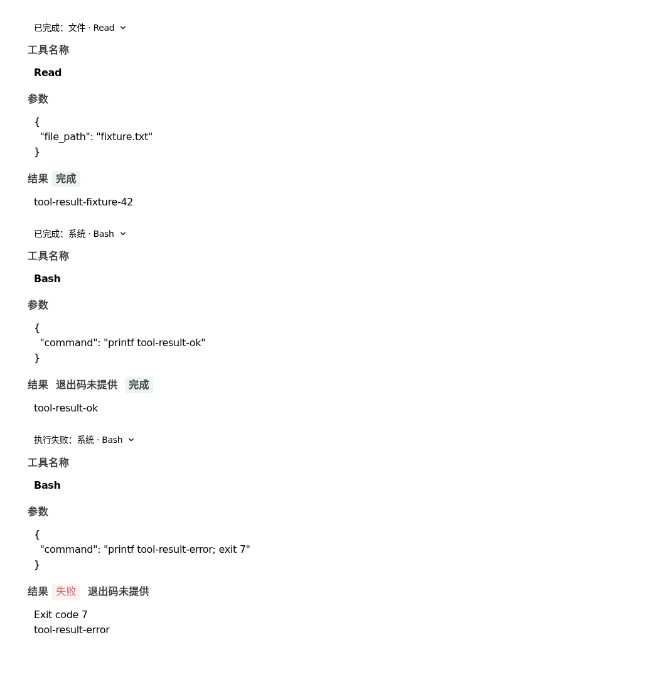

# Claude 工具结果与 Codex TLS 配置接缝

## 根因及决策

2026-10-31 Claude Code 的实际 Code 会话已返回 Read/Bash 内容，却统一显示“命令结果未知”。原生 Bash 记录有 is_error=false、interrupted=false，但没有结构化退出码；Read 已返回文件内容，无命令退出码概念。旧适配器把全部工具标成 command_success=null，前端把该值直接投影为结果未知，混淆调用返回、工具错误、命令退出和任务验收。

修复只在原 Adapter 和现有归一化/工具组件/历史投影接缝：Claude 原生 is_error 保留到 provider.claude 命名空间，显式错误优先；原生整数退出码继续原样使用，缺失/非整数不补值；非 Bash 不产生命令结果字段。前端旧布尔 success 只驱动工具调用展示，不能当作命令退出或任务验收；Bash/shell 已返回但缺码时保留 commandExitUnknown，列表沿原完成/失败显示、详情注明“退出码未提供”。Read 兼容旧历史 null 字段；无原生返回的历史调用仍保留 outcomeUnknown，不伪造完成。事件、真实正文、Task acceptance 与原 Runtime 所有权不变。

Codex 旧错误发生在 resolve_model 的配置检查阶段，并非 TLS 握手失败。移除对 Swarm HTTP-client verify_ssl:false 的两行拒绝；不将该值投影成 CLI 不安全选项，保留官方 SDK/CLI 原 TLS/CA 信任。HTTPS、地址/凭据校验、协议与请求参数限制保留，用户保存的模型字段不重写。Native/OpenCode 模型路径、外部源码/SDK/CLI、版本和依赖锁不改。

官方资料核对：[Python SDK 经本地 app-server 控制 CLI](https://learn.chatgpt.com/docs/codex-sdk)、[官方 CA 环境变量](https://learn.chatgpt.com/docs/config-file/environment-variables)。文档不能替代本轮实测；信任环境继承由当前安装 SDK 源码只读核对及下述连接对照确认。

## 来源及验证范围

独立 worktree artifacts/tool-result-semantics-20261031/swarm，codex/tool-result-semantics-20261031，基线/2026-10-31 fetch 后 origin/main 均 bc3f1881f6364004d04bc4ee048e6348916729ef，开工 clean。旧 desktop-release 候选及主目录不切换、不迁移其 dirty。Core 可选锁 e089198835426cd7681761b0cc278670cd83031f、协议锁 2a0457e5e01152e9ca5f8afdffd84716227046ca 不变。

cwd 为本任务 swarm；Python 使用 artifacts/claude-main-agent-release-20261031/.venv/bin/python，PYTHONPATH=.，实际 jiuwenswarm 导入本候选；SDK 来自该 .venv（openai-codex0.163.0 / claude-agent-sdk0.2.115），无 openjiuwen 安装。数据/模型配置在独立 /tmp/swarm-result-* 下；真实模型凭据从原已验收私有配置读取，不输出、不提交，退出删除临时 config.yaml。不修改系统安装或其它用户会话。

- 确定性后端：pytest 三个 direct adapter 文件（Claude/Codex/OpenCode），最终结果见 本任务根的 evidence/backend-final.log；覆盖 Facade、原控制、历史、缺码/exit0/exit7、错误标志、Read 和 Codex 模型配置 true/false/省略。仅 SDK 替身回归不是端到端成功。
- 前端：原 test:tool-event-normalizer、test:tool-group-display、test:subagent-history、test:tool-result-lifecycle、test:auto-reviewer-events；真实组件 SSR 的 Read/正常 Bash/失败 Bash 行及旧历史、未返回调用语义分别断言，Vite 生产构建。独立 Chrome 组件截图 evidence/tool-results.png，非已安装桌面端验收。
- 真实 Runtime.stream→官方 Codex SDK：Swarm OpenAI 模型 verify_ssl:false，正确返回 4；evidence/live-report.json，未关闭证书校验。
- 真实 Runtime.stream→官方 Claude SDK：Read 返回文件；正常 Bash is_error=false、失败 Bash is_error=true，三者保留各自内容、task_acceptance=unknown；Bash 均未获得结构化退出码，Read 不含 command_success。evidence/claude-final-report.json。
- TLS 对照经同一 Runtime→官方 SDK/CLI，临时 HTTPS 服务/独立 CA 签发 CA:false localhost 证书，无真实密钥。false 且未信任：0 HTTP 请求、原生 UNKNOWN_CA 警报；50秒仍重试，测试主动超时收尾，不记成原生及时退出。false/true/省略且显式信任 CA：到达 HTTPS 服务，无 TLS 警报；服务故意返回401，预期 chat.error，仅证明 TLS 连接，不当模型成功。四项连接断言通过，evidence/tls-final-report.json。

命令及完整日志位于任务 evidence/，临时验收脚本位于任务根，均不进入产品运行流程。首次无隔离 HOME 的测试被文件系统阻止；改隔离环境后，沙箱线程唤醒仍超时；同源码在常规环境通过，不跳过测试。首次真实脚本把 Claude 也设为 verify_ssl:false 被原保护拒绝，修正为 Claude:true 后复验；Codex 首轮无正文不记成功，复跑得到明确答案。初版 TLS 自签 CA 同时用作服务证书，对照失败；修正证书角色后四项通过，旧失败保留。Playwright 默认浏览器缺失后改用已安装 Chrome；未下载或改用户浏览器配置。

## 检视及交付边界

按 jw-review 自检基线至本任务差异，核对单事件消费者、原 Runtime/Facade、历史/实时/预览入口及不安全参数未注入。没有第二调度器、取消流程、替代模型服务或第二 UI 控件。commandExitUnknown 是现有工具结果的展示投影，不是新的执行状态机。只因工具返回/任务完成不能补成功退出码。

本轮无独立评审、stable、干净重新按锁安装、提交/推送/PR、冻结打包或已安装桌面升级；现有 .venv 不是本轮干净按锁验收。Windows/macOS 和 Chrome107 实机未运行。源码与原入口验证完成后仍须在发布关口验证新包与用户配置组合，不能沿用旧包通过。

## 发布授权（2026-10-31）

用户已明确要求执行任务1、提交并合并，忽略 GitHub Actions。本轮按该指令跳过远端 Actions/stable，不改 CI 配置；上述本机验证保留其实际范围。后续新桌面包须包含已有按需安装/菜单刷新修复并重新冻结验收，合入和产物摘要另在交付记录登记。

工具组件实测截图（合成数据，非已安装桌面验收）：

