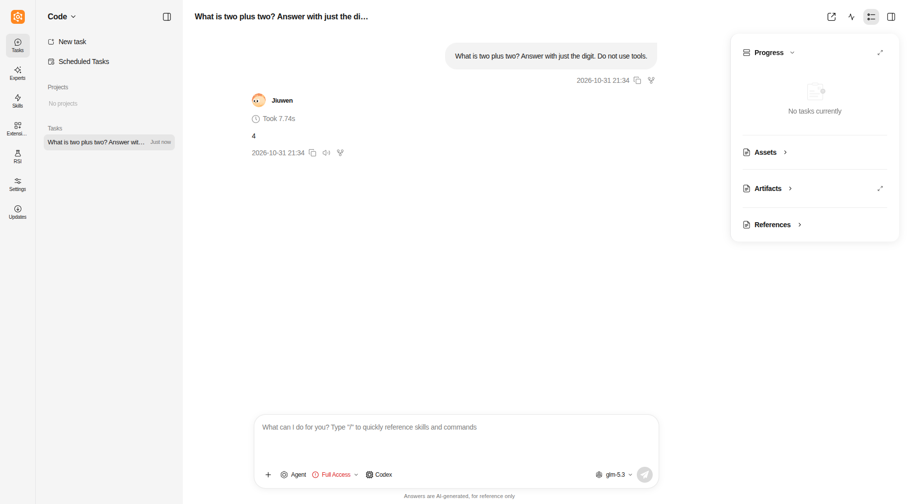
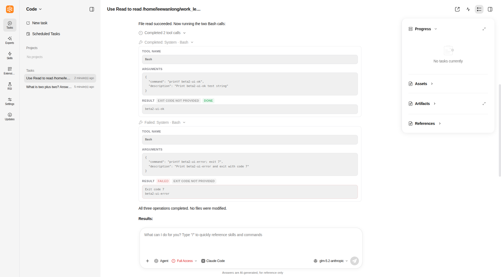
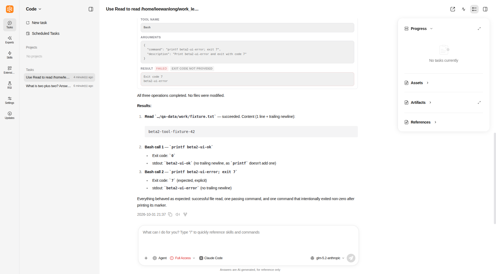

# 桌面安装 SDK 后执行引擎不可选

真实 Electron Linux 外部组合（bc3f188 + 本任务打包修订）在 Front/Worker 已启动后，通过原智能体卡片下载 Codex 和 Claude。原 install_status RPC 均成功，托管目录的官方 SDK/CLI 可正常探测，但原 config.get 返回 enabled=false 和 reason=disabled；用户离开设置页后延迟保存与轮询均已卸载。经原 config.save_all 精确回写用户选择后，enabled=true，但同一个 Front 仍返回 sdk_not_installed：它只在进程启动时激活托管 SDK 路径，而 Worker 在每轮开始的激活无法改变 Front 的 sys.path。

修复将原安装状态轮询及延迟保存移至 App 生命周期（保留 sessionStorage 的 pending choice、原 config.save_all RPC、按 Agent 合并与失败提示），删除页面的重复保存与兜底轮询。保存失败保留意图、重连再尝试，不将安装回执视为已保存；新选择不能被旧回执清除。Front 的目录投影在读取 metadata 前复用原 managed-runtime activation。此函数只暴露正常安装并校验的路径，不安装、不发模型请求，不修改 SDK/CLI。未启用、未安装、SDK异常仍保持不可选；不伪造可用状态。

证据位于管理 artifacts/desktop-release-20261031：current-desktop-config-diagnostic.log（正常认证 RPC）、fix-tests-targeted.log（42项）、native-catalog-tests.log（2项）、frontend-install-tests.log（25项）及重新冻结后的验收。新 React 回归覆盖离开页面、精确保留路径、旧状态去重、失败保留和重连，不再用原组件内代码字符串断言验证延迟回写。跨系统 Front 激活分支只作为单元验证，不能代替 Windows/macOS 实机。

当前旧桌面窗口与用户配置保留；需要启动修订 bundle 才能载入修复，不能通过热改运行中的安装文件冒充交付。原测试包未被覆盖，中间验证包在 dist-menu-fix，最终产物在 dist-menu-final。首次 frozen Runtime 三 Provider 成功只证明执行路径，未证明安装后跨进程目录和页面导航边界；本次补齐该验收缺口。

最终复核补充：显式卡片保存成功后清除该 Agent 旧的 deferred choice，避免一次保存失败后，用户改选路径成功，却在后续重连时回写旧路径。此收尾仍属于原设置保存，不改变 Provider 执行。对应前端重新构建并进入最终安装候选，不将中间包摘要当作最终包。

最终候选真实复验：menu-final-front-report.json 两家可用；menu-final-provider-report.json 三家均正常回答、Runtime关闭且验收配置清理。保持用户当前窗口数据，未热更新或自动重启。完整产物摘要与限制留在管理验证记录。

## 2026-10-31 beta2 发布候选

用户授权任务1提交合并，并明确忽略 GitHub Actions。先合入工具结果/Codex TLS PR4（main 5fc40e2fb098ff3ac6836800cf198f7ac70f6d76），再在独立 desktop-tool-result-release 候选恢复已备份的原桌面按需安装/菜单修复。原候选文件、补丁、未跟踪文件清单及 SHA256 均保留，没有清理或改写用户数据。新版本0.2.5.beta2由原build_config同步，uv.lock只更新workswarm及TUI本项目版本；Core/协议/SDK锁未升级。

联合候选201项后端回归、6个前端测试入口及Electron生产前端构建通过；新建uv sync --locked --no-default-groups --extra dev --no-editable环境实际从site-packages导入0.2.5b2，无Core和Provider SDK。冻结产物与当前用户配置组合待完成验收，本节不是已安装桌面升级结论。用户豁免远端Actions/stable，不把其记为通过。

补充打包契约：原69项中2项旧断言仍要求Electron单安装命令/固定连续参数，未识别现有Native与external分支。产品打包脚本未改；更新测试覆盖两条分支归属、external不带Core/CUA、所有Windows分支仍限定x86_64目标，CLI SDK排除不变；最终69项通过。初次2失败/67通过日志保留，不跳过或新增白名单。本测试为源码契约，不代表Windows/macOS实机运行通过。

## beta2 冻结与实际桌面验收

新建按锁非editable环境冻结后端，版本0.2.5b2，未包含Core或预装Provider SDK；原Gateway安装/既有Front热发现两家SDK通过。正式deb和便携包复用同一后端、前端与资源，关键文件摘要一致，模板中仅环境占位，当前用户实际密钥扫描零匹配。

实际验收配置从当前系统桌面配置复制，模型字段未改值：Codex原verify_ssl:false、Claude原Anthropic模型（verify_ssl省略）、OpenCode原OpenAI模型。新冻结Runtime三家真实调用全部通过，Claude Read/正常Bash/失败Bash原生事实和缺失退出码保留。独立Electron桌面Code界面三家可选，Codex正常返回4并刷新保留；Claude显示Completed Read、Completed Bash、Failed Bash，两个命令详情均注明退出码未提供，刷新同样保留。截图如下，均为独立QA数据，不含密钥。

QA桌面通过正常SIGTERM收尾，其12个所属进程均退出，私有配置删除；原系统窗口/配置未动。自动化曾引用未显示侧栏控件、未展开原耗时折叠栏，以及在异步目录加载完成前断言标签；修正脚本使用当前可见入口/原折叠栏和等待条件后通过，未改产品控件、增加流程或重发模型输入。首次结束进程校验把启动器路径当作exec后路径，校验拒绝后改为实际Electron路径+独立user-data-dir双重核对，再完成正常收尾。

用户授权本次忽略GitHub Actions，远端Actions/stable不计通过。Windows/macOS及系统deb实际安装升级未执行；Linux便携桌面与deb同源关键文件一致，安装包供正常升级。冻结时产品源码提交5a32432，后续提交仅测试/受管文档，不改变运行代码；交付时核对合入源码和运行代码一致。

- `workswarm-external-linux-amd64.tar.gz`：453123920 bytes；SHA256 `cd2bd1bcda372813544a489fc19a4c3d0dc9e3bdfe8ff208add165bded610dfb`。

- `workswarm-external_0.2.5.beta2_amd64.deb`：453056120 bytes；SHA256 `f3f35ee9497c15ffb757aec0da26f06c4eb76dfd9008d54394a284a5d2cd115d`。
