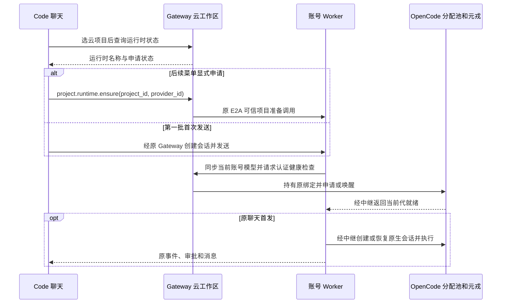

# OpenCode 云端运行时申请与 Code 聊天接入

## 1. 结论与范围

可行。首次发送按需分配已经在托管 OpenCode 链路中实现。第一批闭合 Code 普通单智能体会话（`agent.code.normal`）的 Provider 名称、选择与真实首发。新建任务复用 Code 新对话，使用原草稿、附件、模型、发送、审批、停止和历史。运行时概览放在左侧主导航，和云端项目菜单的显式申请均后置，可独立接入。沿用现有一个 Worker 环境对应一个共享 OpenCode 绑定的方式，适用范围为同一账号、同一文件信任域。

本提案扩展云项目准备完成后的执行环节。项目准备用 GitHub、GitCode 或已有目录登记工作区，账号 Worker 服务原会话，OpenCode 容器提供执行。三者分别就绪。此前云项目准备设计和现行绑定契约继续作为依据。 [云项目环境设计](../D-20261116-1851-github-cloud-environment-alignment/design.md) · [云账号与实例契约](../../../specs/gateway/S_01_cloud-account-instance.md)

审阅基线为 `code-platform` 刷新后的 `origin/main`，于 2026-11-22 01:43（UTC+8）核对远端引用与任务 HEAD 均为 `edbcaca624b29c267f39841328239027bab55daf`。主目录与任务起点均干净。本地参考 `code-core` `de8d4f38bb624b608af4a5c76b5c5c82d47d3360`、`codeswarm` `24f29148193b5b590fe9f4b3e21f779c87253e5e`，两者均干净。平台锁定上游 agent-core `e089198835426cd7681761b0cc278670cd83031f` 和 agent-protocol `2a0457e5e01152e9ca5f8afdffd84716227046ca`。本轮采用源码审阅，平台进程及锁定 Core 的实际运行导入留待候选验证。 [平台依赖锁](../../../../../uv.lock)

## 2. 当前能力与可行性

| 接缝 | 源码事实 | 对应交付 |
| --- | --- | --- |
| Code 聊天 | `enterNewConversation` 进入 `chat-new`。首发复用 `session.create` 的 `create_token` 去重，再调用原消息发送。项目、Provider、模型已经有相应参数和状态。 | 第一批在原 Code 普通会话草稿显示并选择有名称的 OpenCode 运行时。 |
| Provider 按需启动 | Adapter 从已绑定会话取项目根，先同步账号模型，再走签名中继的 `global/health`。中继通过 `CloudOpencodePool.hold` 分配容器、检查元戎状态和认证健康，再创建原生会话。 | 第一批从现有聊天发送入口验证真实首发、原会话回复和失败反馈。 |
| 显式申请 | 项目菜单目前负责项目列表、目录和仓库准备。OpenCode 分配池已有稳定绑定锁、回执、就绪探针及回收器。 | 后续在项目菜单增加显式申请，共用原绑定、检查和分配链。 |
| 端云路由 | 直接云 Web 走现有云 WebChannel。本机 Web 或桌面切云后，云桥按当前账号授权并解码项目地址，移除浏览器传入的绝对路径。 | 两个入口挂同一云方法。响应按当前账号、项目和视图代次接收。 |

[新会话与发送入口](../../../../../jiuwenswarm/channels/web/frontend/src/App.tsx) · [执行方式选择器](../../../../../jiuwenswarm/channels/web/frontend/src/components/ChatPanel/ExecutionPicker.tsx) · [OpenCode Adapter](../../../../../jiuwenswarm/server/runtime/agent_adapter/providers/opencode.py) · [云桥](../../../../../gateway/services/cloud_execution_bridge.py)

现有记录曾在隔离 YuanRong 与官方 OpenCode 1.18.18 上验证同账号双项目共用容器、跨账号分配及物理回收后恢复。记录对应历史候选。新状态接口、显式申请、混合版本和 UI 首发反馈需要在本分支实现后重新验证。 [共享绑定及验证记录](../../../features/F_20261121_0233_opencode-worker-shared-provider.md) · [新绑定准入验证](../../../features/F_20261121_1751_opencode-global-admission.md)

## 3. UI 位置与工程接入

### 三个操作入口

| 位置 | 用户看到和操作的内容 | 现有工程接缝 |
| --- | --- | --- |
| **第一批，Code 新对话 → 输入框底部 → Provider** | 选择云端项目且处于普通单智能体会话时，原 OpenCode 条目显示「OpenCode · 云端开发环境」。选择动作、模型校验和会话锁定沿用原控件。 | `InputArea` 按现有工作模式与计划状态确定普通会话。由 `ExecutionPicker` 组合现有目录与项目运行时摘要，云数据取得与解析放在 `features/cloudWorkspace`。 |
| **后续，左侧主导航 → 运行时** | 建议放在最左侧导航栏的「专家」与「技能」之间，与「任务」同级。点击在主内容区查看当前云账号的运行时名称、Provider、申请状态和绑定概况。 | 接入现有 `SessionSidebar` 与 `App` 主内容区，业务页面归 `features/cloudWorkspace`。按已配置的云运行时能力启用入口，账号级查询可在选项目之前进行。 |
| **后续，Code 云端项目菜单 → 新建云端设备** | 选定项目后可显式申请并查看进度。正常首发可按需启动。 | 在 `CodeWorkspaceControls` 既有云端菜单加一项，使用同一个项目运行时客户端和现有云账号连接。 |

左栏概览和项目菜单分别使用账号级与项目级授权，两处展示名取自同一份 Gateway 配置。托管运行时的镜像登记、名称和申请准入由部署运维配置管理。三方 Agent 的开关、安装与 CLI 路径继续由现有账号设置承担。云账号鉴权提供主体身份，将来引入网页管理动作时由服务端明确授权运维角色。 [左侧主导航](../../../../../jiuwenswarm/channels/web/frontend/src/components/SessionSidebar/index.tsx) · [普通与计划模式解析](../../../../../jiuwenswarm/channels/web/frontend/src/features/planMode/wireMode.ts) · [云账号身份](../../../../../gateway/auth/account_authenticator.py)

### 模块职责与解耦方式

- **Web Chat**。继续使用 `ChatPanel`、`InputArea`、`ExecutionPicker`、`ChatModelSelector` 和 `CodeWorkspaceControls`。云项目选定后，前端按可信目标读取运行时状态，并将名称附加到现有目录中的 `opencode-direct` 条目。派发和会话绑定仍使用原 Provider ID。只在 Code 云端项目草稿中应用托管展示和申请能力。 [云端项目控件](../../../../../jiuwenswarm/channels/web/frontend/src/components/ChatPanel/CodeWorkspaceControls.tsx) · [目录读取](../../../../../jiuwenswarm/channels/web/frontend/src/features/cloudWorkspace/useCloudCatalog.ts)
- **Gateway 云工作区扩展**。在现有插件组合点挂接一个项目运行时控制处理器，使用原账号认证、项目解析及云桥。它负责公开状态、准入和转交申请。GitHub/GitCode 准备处理器继续专注仓库和目录准备。首期的运行时名称由私有部署配置 `opencode_provider.display_name` 提供，建议缺省为「云端开发环境」。新字段需要加入 Gateway 校验与公开投影。调整展示名后，Gateway 重载并由前端刷新状态即可生效，Worker 和 Provider 容器无需为改名换代。可写运行时管理页可独立接入同一配置权威。 [现有插件装配](../../../../../gateway/services/cloud_workspace_assembly.py) · [部署配置校验](../../../../../gateway/extensions/cloud_workspace/config.py)
- **账号 Worker**。第一批沿用 Adapter 已有的模型同步、签名中继与认证健康探测。显式申请阶段再增加受信的轻量准备调用，将两条入口共同需要的逻辑放到 OpenCode 专属模块。Front/Control 复用现有 E2A 编解码与可信路由，保持轻量导入边界和现有会话权威。 [现有轻量 Control 方法分类](../../../../../jiuwenswarm/server/control/methods.py) · [现有协议接缝](../../../../../jiuwenswarm/common/schema/message.py)
- **Provider 池与部署层**。复用 OpenCode 中继、元戎 SDK 客户端、`CloudOpencodePool`、`provider_bindings`、项目会话归属索引以及物理确认。镜像、版本化启动栈、挂载、资源、凭据和生命周期由可信部署层掌管。以后接入第二个 Provider 时，可在云工作区装配点增加专属处理器，复用项目范围的公开状态语义。OpenCode 的 HTTP/SSE、模型投影和权限规则留在 OpenCode 模块。 [池与就绪检查](../../../../../gateway/services/cloud_opencode_pool.py) · [节点发布与回滚](../../../../../deploy/cloud-workspace/OPENCODE_RELEASE.md)

### 接入取舍

推荐 Worker 发起预启动。当前首发先执行 `account-models/sync`，模型片段发生变化时会在空闲边界回收旧启动配置并换代。若 Gateway 菜单请求直接对空配置调用 `hold`，首发可能紧接着回收刚预热的容器。复用 Worker 的模型同步顺序可消除这次重复启动，并保留凭据的现有私有传输。代价是补一个受信的 Worker 准备接缝，并验证其可独立于 Runtime 会话启动。

运行时名称与状态建议通过项目范围的接口公开。把名字随现有 Worker bootstrap 下发会受其启动快照约束，改名会依赖 Worker 重启。项目状态接口让 Gateway 配置与绑定成为名称、状态和准入的权威，Worker 仍提供原 Provider 目录和模型兼容性。首期用 `project_id` 和既有 Provider ID 确定目标。若将来同一目标允许两个同类 Provider 运行时，再扩展选择键及服务端持久绑定契约。 [模型同步与回收](../../../../../gateway/services/cloud_opencode_pool.py) · [Worker 引导配置装配](../../../../../gateway/services/cloud_workspace_assembly.py)

## 4. 接口和调用流程草案

| 入口 | 建议输入与输出 | 状态权威与副作用 |
| --- | --- | --- |
| `project.runtime.status` | 第一批。输入 `project_id`。返回 `provider_id`、稳定 `runtime_profile_id`、`display_name`、可用性及有限原因码。设备生命周期状态随后续视图补齐。 | 使用当前账号和项目根核验。打开聊天页或菜单保持零分配、零状态写入。 |
| 原 `session.create` → 首条 `chat.send` | 第一批。沿用项目、Provider、模型、草稿及 `create_token` 契约。 | 正常 Code 会话的创建与原生会话分配仍由原链主导。明确结果后沿原会话显示执行、审批、停止与历史。 |
| `cloud.runtime.list` | 左栏阶段。返回当前账号的运行时 ID、Provider、展示名、申请状态及绑定概况。 | 可在选项目之前调用。云桥仅为该确切方法开放无资源选择器的只读转发。 |
| `project.runtime.ensure` | 显式申请阶段。输入 `project_id` 和 `provider_id=opencode-direct`。返回最新公开状态或可重试错误。 | 云账号授权通过后，转交当前 Worker 同步模型与健康探测。重复或并发请求共享现有池锁和代次。成功表示申请时刻容器已通过认证健康检查。 |

`runtime_profile_id=opencode-cloud` 是首期服务端稳定标识。状态输出可采用 `not_created`、`starting`、`ready`、`idle`、`reconciling` 及 `unknown`。无行或初代 NEW 对应未创建。已确认旧代退出且待下次分配的 NEW 可以显示休眠。元戎 ALLOCATED 单独不足以显示就绪，使用当前代最近一次通过的认证健康事实，并附检查时间，重启后的未知状态应显式显示。准入独立于设备状态，暂停申请时原绑定仍可恢复。公开字段仅供展示和交互判断，服务端始终重验权限和当前代次。

左栏概览和项目状态复用同一份 Gateway 运行时元数据和现有 Provider 绑定。左栏概览以当前账号已登记环境为范围，项目状态再校验项目可见性和工作目录。Worker 能力无法从当前响应确认时，显式申请显示待核验。状态读取本身不得经会触发账号 Worker 启动的 Router ensure。显式申请采用有界请求，等待超限后回到原绑定查询。既有持久回执、分配锁和回收器承担恢复，应用层保持同一条容器生命周期。

申请和首发以同一个 `账号 × 稳定 Worker 环境 × Provider` 为分配粒度，项目 ID 用于权限核验、CWD 与原生会话归属。共享容器实际挂载同账号 Worker 的项目文件根。跨项目的中继会话授权与容器内文件可见范围分别验收。若业务要求同账号项目间文件隔离，需另选单项目挂载和对应绑定粒度。新菜单仅显式触发申请，选择项目、展开菜单与改 Provider 保留草稿。

## 5. 失败、兼容与退出

- **身份与边界**。直接 Web 和本机/桌面云桥都使用现有云账号协议。浏览器提供项目资源 ID，Gateway 解析并核对当前账号、规范项目根、Worker epoch 和运行时准入，Worker 使用原签名中继。UI 返回公开字段，元戎端点、安装路径、凭据和内部回执留在服务端。应用容器内的实际挂载及同 UID 可读面以实测为准。 [Relay 项目校验](../../../../../gateway/services/cloud_opencode_relay.py) · [宿主边界](../../../../../deploy/cloud-workspace/LOG_BOUNDARY_CONTRACT.md)
- **启动慢或两端断开**。浏览器等待、Gateway 转发、Worker 准备、分配锁及元戎/健康探针共享有界预算。超时后按绑定状态查询和显式重试，丢弃账号或项目切换后到达的旧响应。元戎已请求但结果不明时沿用原对账。物理退出未确认时维持原代次。消息接受状态以既有会话、历史及请求事件核对，页面重连沿用原恢复语义。
- **停发与旧版本**。保留 `admit_new_bindings` 和旧 `account_allowlist` 的现有部署语义。旧 Gateway 缺少新增查询时，继续使用原 Provider 目录与首发链。新 Gateway 遇到缺少准备能力的 Worker 时，菜单显示该能力不可用，托管首发能力继续按原规则判断。若配置了托管 OpenCode 且当前申请被拒，显示原因，保留草稿供用户改选。旧项目级绑定按持久记录恢复，已有共享绑定沿原卷和原生会话 ID 唤醒。
- **独立发布与回退**。可先部署状态投影和名称，再部署 Worker 准备接缝和菜单动作。容器镜像更新采用现有全池预置、物理确认和离线绑定迁移流程。UI 或准备能力退回旧版本后，核心执行仍由原会话、中继和绑定状态承担。 [镜像资产回滚](../../../../../deploy/cloud-workspace/OPENCODE_RELEASE.md)

## 6. 实施拆分和验收

1. **先闭合 Code 普通会话的 Provider 与首发**。Gateway 从部署配置公开项目范围的名称和准入，在原下拉框展示 `OpenCode · 云端开发环境`，保留稳定 `opencode-direct` 与原模型选择。选择项、展开和查询均无容器创建副作用。点击发送后使用现有会话入口和分配池，用户在同一聊天页看到回复或明确失败。首批实际验收覆盖尚无容器的真实首次发送、认证就绪、持久绑定与同一会话续聊，以及普通会话已有的审批、停止与历史。回归覆盖本地/云端切换、账号和项目变化、准入关闭、旧版本、计划和集群模式。通过后才进入后续两项。
2. **新增左侧主导航「运行时」**。接入最左栏「专家」与「技能」之间。在原应用壳中接账号级只读概览，使用第一批相同的名称与绑定来源。验证按账号显示、云能力缺失、菜单进入和返回聊天后的草稿保留。导航页面与聊天首发独立。
3. **接云端项目菜单显式申请**。抽取并复用 Worker 的 OpenCode 准备接缝。验证显式申请完成后没有空会话，菜单与首发并发仍只有一个稳定绑定和同一代容器。账号模型配置未变时，首发复用已启动容器。申请入口与左栏概览各自接入。

真实验收使用固定 OpenCode 镜像及元戎隔离池，覆盖云 Web 与本机/桌面经云桥的受影响入口。按阶段记录源码和依赖实际导入、镜像和启动栈摘要、状态回执及真实工具副作用。后续生命周期专项覆盖双账号隔离、同账号双项目、回收确认、模型变化与旧原生会话恢复。前端沿用中英文、主题、testid 和 Chrome 107 约束。 [现有分配池测试](../../../../../tests/unit_tests/cloud_workspace/test_cloud_opencode_pool.py) · [云中继测试](../../../../../tests/unit_tests/cloud_workspace/test_cloud_opencode_relay.py) · [聊天 Provider 测试](../../../../../jiuwenswarm/channels/web/frontend/tests/executionProviderSelection.test.mjs)

2026-11-22 形成初稿。实施前需核实轻量 Worker 接缝的导入边界、真实冷启动耗时和混合版本能力检测。产品上首期以当前账号为共享范围，运行时名称由运维配置。

2026-11-22 按用户确认将「运行时」放在左侧主导航，实施顺序改为先闭合 Code 普通会话的 Provider 与真实首发。左栏概览与项目显式申请作为后续独立增量。

2026-11-22 用户确认左栏位置为「专家」与「技能」之间，批准第一批 Code 普通会话的接入与验收。

2026-11-22 第一批验收通过后，用户确认在同一分支实施左栏「运行时」和云项目菜单「新建云端设备」，沿原分配链及 Provider 下拉框验证显式申请后的选用。
